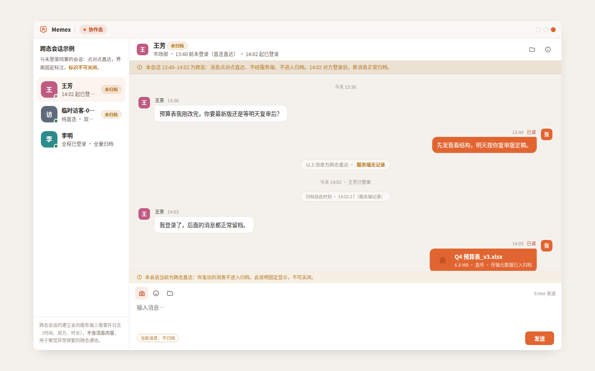
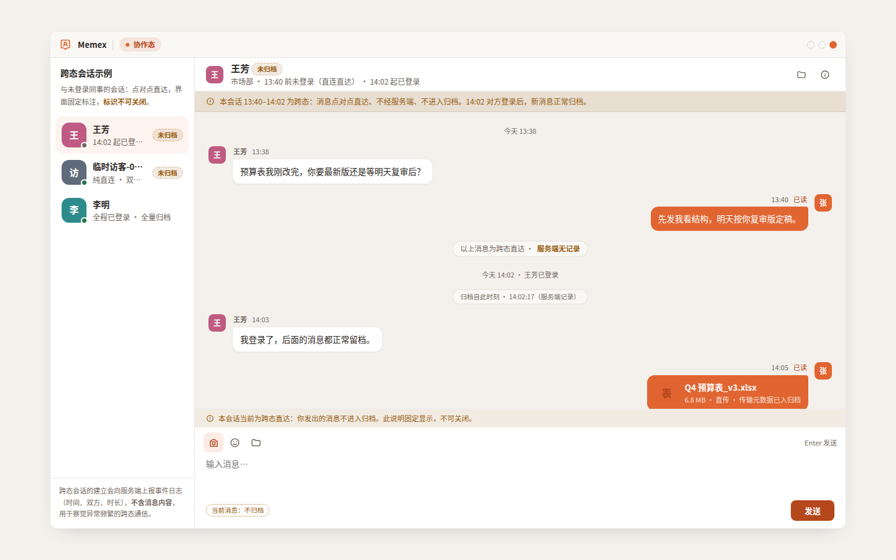
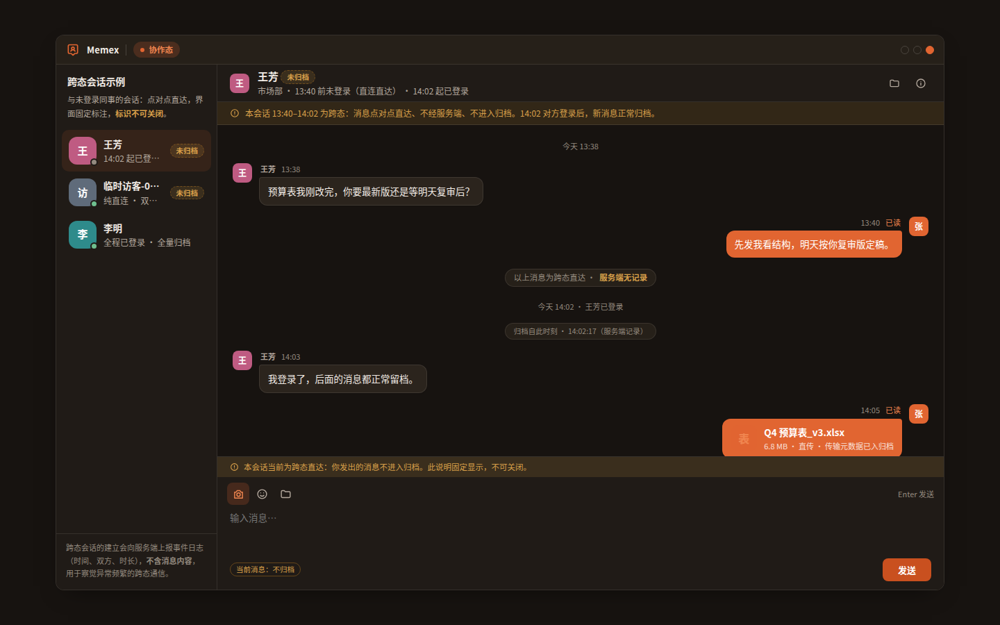
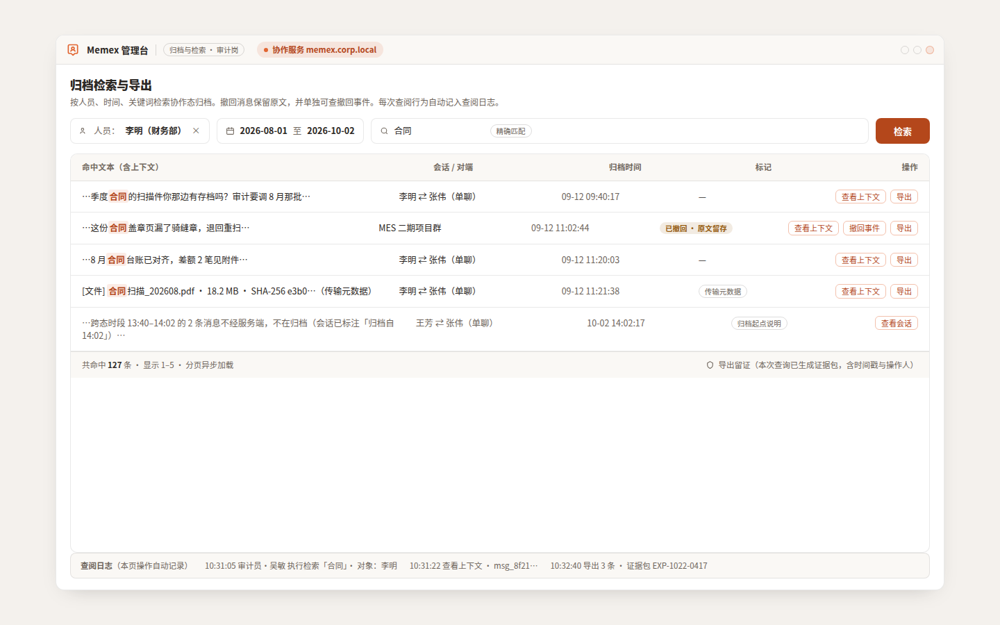
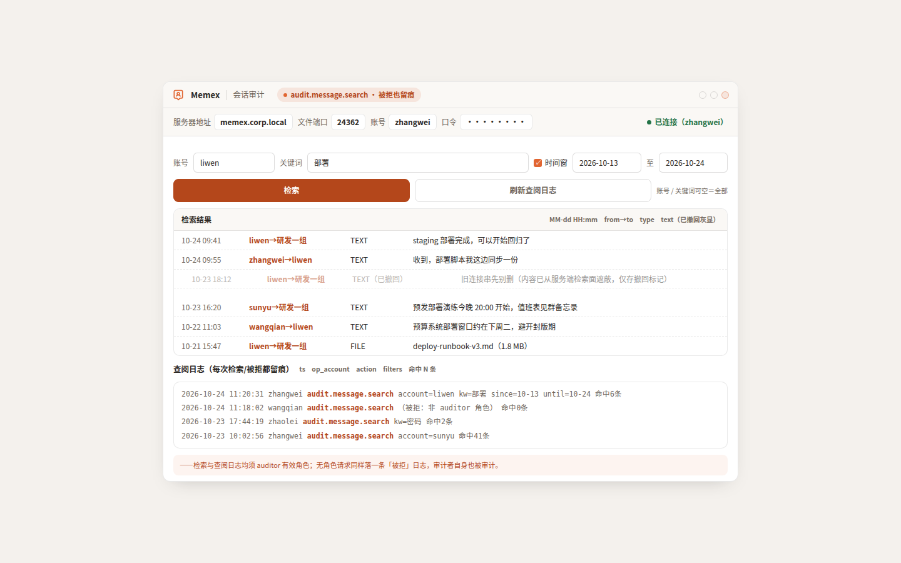
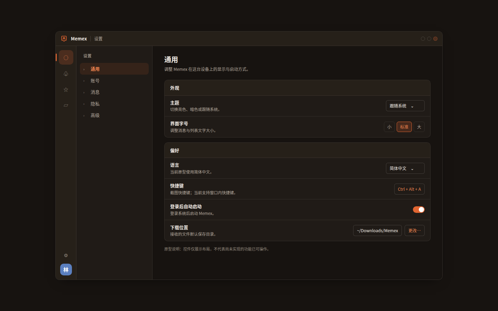

# UI Audit (impeccable) — admin 原型界面 · 2026-10-31

- 范围:`docs/design/prototypes/` 全部 **36 个原型**(30 桌面 + 6 移动),共享设计系统 `prototypes.css`;对齐台账见 `docs/design/prototype-conformance.md`(28 已对齐 / 6 有偏差 / 0 未实现)
- 工具:impeccable v4.8.0(audit 维度:层级 / 排版 / 色彩对比度(WCAG 1.4.3 / 1.4.11 / 2.4.7)/ 动效 / 响应式 / 边界态 / UX 文案)
- 运行方式:静态原型可直接渲染,无构建;真实浏览器截图(Playwright Chromium,桌面 1440×900,移动 460×860;亮/暗双主题 `?theme=dark`)

## 整体 critique(不留情面)

这套原型是**这批审核里少见的、做得像样的一套设计系统**——不是"能看",而是"有判断"。品牌橙 `#e16531` 落在暖米白 `#f4f1ed` 上,双主题(亮=办公主形态,暗=暖近黑变体)是同一种气质的明暗两面;30 个桌面 + 6 个移动屏共用 rail(60px)+ sidebar(272px)+ main 的骨架,会话列表、聊天气泡(含引用、文件卡片、系统胶囊)、归档检索控制台、组织架构、设置表单、移动端 tabbar/向导,层级和留白都在一个节奏上。逐屏看,没有破碎布局、没有错位、没有未对齐的栅格——这在 36 屏里是真的难做到。

**但它的短板全在"看不见的地方",而这恰恰是它最致命的:** 所有承载文字的主行动面(发送 / 检索 / 打开通讯录 / 下一步·登录账号 / 未读角标 / 己方消息气泡)都是**白字压在品牌橙上,对比度只有 3.44:1**,低于 WCAG AA 的 4.5:1——这是用户每按一次都会碰到的元素;三级灰文字(时间戳、分组标签、提示、空态引导)只有 **2.75–3.09:1**;警示橙文字 3.64:1、成功绿文字 4.25:1,对它们 11–12px 的字号都是不达标的;品牌深橙文字压在品牌浅橙底上 4.35:1 擦线。另外,搜索/筛选/输入区/向导的输入框全部 `outline: none`,**键盘焦点完全不可见**。这些缺陷你在截图里一眼看不出来——屏幕看起来"很顺眼",正因为如此才更需要这次审计。好在病灶高度集中在 `prototypes.css` 的令牌上,修复是**令牌级**的:品牌色相与暖灰质感原样保留,只把承载文字的橙面换到同色相的 AA 变体(亮 #b4471b 5.44:1 / 暗 #c9501f 4.52:1),把三级灰与警示/成功文字压到各自 ≥4.5:1,并恢复焦点可见。视觉方向未动,合规性补齐。

层级/排版/响应式/边界态/UX 文案**无坏损**;空态、系统胶囊、撤回回显、归档起点说明、登录引导这些边界态都做到了,值得肯定。

## 问题清单(按严重度)

| # | 严重度 | 问题 | 定位 | 处置 |
|---|---|---|---|---|
| 1 | **高** | 白字压品牌橙 #e16531 = **3.44:1**,所有主行动面(发送/检索/打开通讯录/下一步/未读角标/移动发送钮/己方气泡)不达 AA | `prototypes.css` `--brand` 系 + `.send-btn`/`.btn.primary`/`.btn-search`/`.w-btn`/`.n-count`/`.m-send`/`.msg.mine .bubble` | **已修**(新增 `--brand-fill`:亮 #b4471b 5.44:1,暗 #c9501f 4.52:1) |
| 2 | **高** | 三级灰 `--text-3` #9b9187 = 白 3.09 / 底 2.75 / 面板2 2.92 —— 时间戳、分组标签、提示、空态文字不达 AA | `prototypes.css` `--text-3`(亮/暗) | **已修**(亮 #736a61:5.15/4.71/5.00;暗 #948a7f:5.04/5.45/4.76) |
| 3 | 中 | 警示 `--warn` #b7791f = 白 3.64 / warn-soft 3.17 —— 横幅、输入说明条、未归档徽标不达 AA | `prototypes.css` `--warn`/`--warn-soft` | **已修**(#965c11:5.47 / 4.63) |
| 4 | 中 | 成功 `--ok` #2e8b57 = 4.25:1 —— 状态徽标擦线不达 AA | `prototypes.css` `--ok`/`--ok-soft` | **已修**(#237347:5.81 / 4.89) |
| 5 | 中 | 品牌深橙 `--brand-deep` #bc4c1f 压 brand-soft = 4.35:1 —— 协作徽标/角色标签擦线 | `prototypes.css` `--brand-deep`(亮) | **已修**(#b4471b:4.73) |
| 6 | 中 | 搜索/筛选/输入区/向导输入框 `outline:none`,键盘焦点不可见(WCAG 2.4.7) | `prototypes.css` `.search input`/`.filter input`/`.input-area textarea`/`.w-input input` | **已修**(`:focus-visible` 恢复 2px 品牌描边) |
| 7 | 低 | rail 图标 tooltip 仅 `:hover` 展示,键盘不可达 | `prototypes.css` `.rail .rail-item .tip` | **已修**(`:focus-visible` 同步展示) |
| 8 | 低 | 头像初始字白字对比 3.64–4.17:1(v3/v4/v5/v6/v7)不达 AA | `prototypes.css` `.avatar.vN` | todo(判定为装饰性——姓名必在邻位;为保留多彩身份色板未改) |
| 9 | 低 | 非文本组件对比临界:进度条/向导步进/rail 激活条(brand 压 panel-2 ≈2.9:1);office-map 座位标记 #E88A2A/#2A82E8 | `prototypes.css` `.tx-bar i`/`.w-steps i.on`/`.rail-item.active::before`;`desktop-office-map.html` | todo |
| 10 | 信息 | 无 DESIGN.md / PRODUCT.md(原型 CSS 即事实设计系统;台账承担规格→实现映射) | 仓库根 | 记录缺失 |
| 11 | 信息 | impeccable 检测器 warning:`side-tab` 品牌左边条(3px,rgba .55)于 `.bubble .quote` | `prototypes.css:277` | 判定为引用块刻意指示,不改(非坏损) |
| 12 | 信息 | `body{overflow:hidden}` + 固定 `.window` 1280×800:视口 <1280px 时裁切(main-empty 已用 `min()` 缩放) | `prototypes.css` `body`/`.window` | todo(加小视口缩放,便于审阅) |
| 13 | 信息 | 令牌变更会拉开原型与已对齐 C++/Kotlin 实现的颜色偏差 | `docs/design/prototype-conformance.md` | 台账侧待同步(本审计改的是设计基准,非实现) |

## 截图(前后对比)

修复前→后,亮/暗双主题。主行动面(己方气泡、未读角标、发送钮)由亮橙加深为 AA 变体,三级灰/警示/成功文字加深,品牌色相与暖灰质感不变。

| 页面 / 状态 | 截图 |
|---|---|
| 桌面聊天 · 亮 修复前 |  |
| 桌面聊天 · 亮 修复后 |  |
| 桌面聊天 · 暗 修复前 |  |
| 桌面聊天 · 暗 修复后 |  |
| 归档检索导出 · 亮 修复后 |  |
| 会话审计控制台 · 亮 修复后 |  |
| 移动端聊天 · 亮 修复后 |  |
| 设置·通用 · 暗 修复后 |  |

## 对比度实测(修复后)

| 令牌/元素 | 前景/背景 | 比值 | WCAG |
|---|---|---|---|
| `--brand-fill` 亮 #b4471b / 白字 | 5.44:1 | AA ✓ |
| `--brand-fill` 暗 #c9501f / 白字 | 4.52:1 | AA ✓ |
| `--text-3` 亮 #736a61 / 白 | 5.15:1 | AA ✓ |
| `--text-3` 亮 #736a61 / 底 #f4f1ed | 4.71:1 | AA ✓ |
| `--text-3` 暗 #948a7f / 面板 #201b17 | 5.04:1 | AA ✓ |
| `--warn` #965c11 / 白 | 5.47:1 | AA ✓ |
| `--warn` #965c11 / warn-soft | 4.63:1 | AA ✓ |
| `--ok` #237347 / 白 | 5.81:1 | AA ✓ |
| `--ok` #237347 / ok-soft | 4.89:1 | AA ✓ |
| `--brand-deep` #b4471b / brand-soft | 4.73:1 | AA ✓ |
| 正文 `--text-1` / 白 | 14.8:1 | AAA ✓ |

## 测试门禁

原型为纯静态设计基准,无单测;本次改动仅 `prototypes.css` 令牌与焦点规则,无逻辑变更。CI 无针对 `docs/design/prototypes/` 的断言。

## 就地修复 commits

- `fix(ui): meet wcag aa on primary action buttons`(#1)
- `fix(ui): raise muted and brand text contrast for wcag`(#2,#5)
- `fix(ui): raise warn and ok text contrast for wcag`(#3,#4)
- `fix(ui): restore keyboard focus visibility on inputs`(#6)
- `fix(ui): meet wcag aa on outgoing message bubble`(#1 补充)
